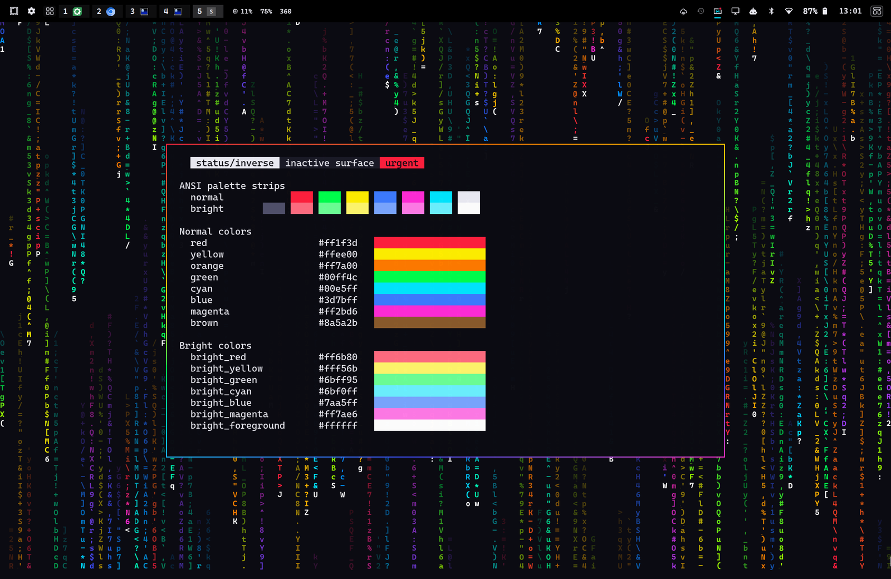
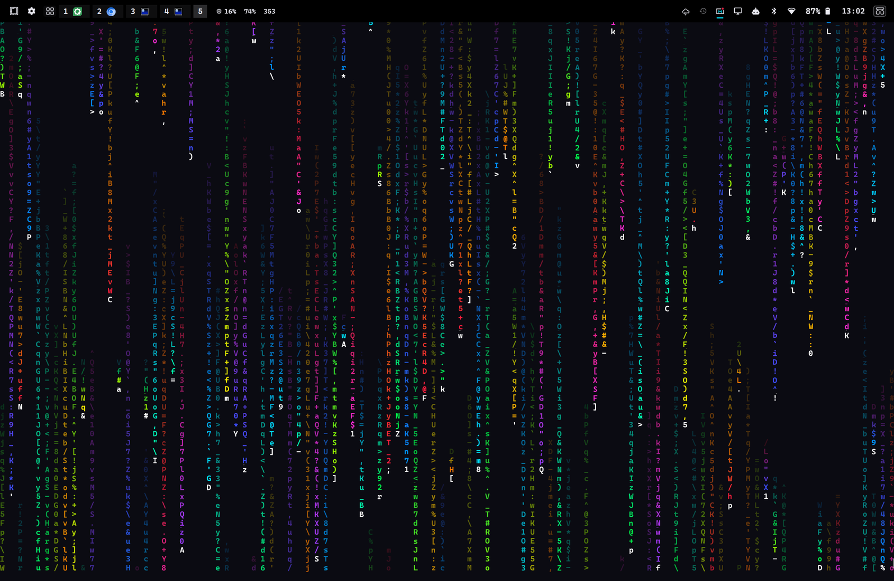

# Spectrum — an Omarchy theme

Full-rainbow RGB gaming lighting for [Omarchy](https://omarchy.org): saturated neon hues on a near-black chassis,
like a Razer Chroma keyboard in spectrum-cycling mode. Windows get a rainbow light-strip border, and the desktop
can run a live matrix rain in all twelve colours of the wheel with white tracer heads.



## What's in it

| File | What it does |
|---|---|
| `colors.toml` | The palette Omarchy builds every app's theme from (terminals, bar, menus, Hyprland, btop, Neovim…) |
| `icons.theme` | GTK icon theme: `Yaru-magenta-dark` |
| `omatrix.toml` | Settings for the live matrix-rain wallpaper (needs the [omatrix](https://github.com/0x1ocean/omarchy-omatrix) plugin; ignored without it) |
| `backgrounds/1-spectrum-glow.webp` | Static wallpaper, used when the rain is off |
| `preview.png` | Thumbnail for Omarchy's theme switcher |
| `extras/omatrix/` | Optional patches for the omatrix plugin that add the 12-colour rainbow rain ([details](extras/omatrix/README.md)) |

### Palette

| | Normal | Bright |
|---|---|---|
| Red | `#ff1f3d` | `#ff6b80` |
| Orange | `#ff7a00` | — |
| Yellow | `#ffee00` | `#fff56b` |
| Green | `#00ff4c` | `#6bff95` |
| Cyan (accent) | `#00e5ff` | `#6bf0ff` |
| Blue | `#3d7bff` | `#7aa5ff` |
| Magenta | `#ff2bd6` | `#ff7ae6` |
| Background / Foreground | `#0b0b12` | `#eaeaf2` |

Active window border: a 45° red → orange → yellow → green → cyan → blue → magenta gradient.
There are no grey UI accents beyond the surfaces: everything that can be coloured is a hue.

## Install

```bash
omarchy theme install https://github.com/WhiskeyTangoFussell/Omarchy-Theme-Spectrum.git
```

This clones the theme into `~/.config/omarchy/themes/` and applies it straight away. Omarchy names the theme
after the repository, so it is listed as **omarchy-theme-spectrum** in the theme switcher
(`SUPER + SHIFT + CTRL + SPACE`).

To get it under the short name `spectrum` instead, clone it yourself:

```bash
git clone https://github.com/WhiskeyTangoFussell/Omarchy-Theme-Spectrum.git ~/.config/omarchy/themes/spectrum
omarchy theme set spectrum
```

Update later with `omarchy theme update` (or `git pull` in the theme folder), and remove with
`omarchy theme remove <name>`.

## The matrix rain (optional)



The rain is drawn by the [omatrix](https://github.com/0x1ocean/omarchy-omatrix) shell plugin, which turns on
whenever the active theme ships an `omatrix.toml`:

```bash
omarchy plugin add https://github.com/0x1ocean/omarchy-omatrix.git --enable
```

How it looks depends on which omatrix you have:

| omatrix | Rain |
|---|---|
| Not installed | No rain; the `1-spectrum-glow` wallpaper shows |
| Stock upstream | Classic green rain (the theme's `#00ff4c`) with white heads. The rainbow keys are ignored, nothing breaks |
| With the patches in [`extras/omatrix`](extras/omatrix/README.md) | The full effect in the screenshot: each stream picks one of 12 hues, its tail fades from bright to dark (`tail_fade = 0.85`) and drifts three steps round the colour wheel (`tail_hue_shift = 3`), heads are white, and it updates at ~10.7 Hz |

The rain pauses behind fullscreen windows and while locked, and slows down on battery
(`on_battery = "slow"`). The rain costs about 0.02 W on an M2 MacBook Air, which is negligible.

## Requirements

- Omarchy 4 (the shell-based release with `omarchy theme install` and shell plugins)
- `Yaru-magenta-dark` icons — shipped with Omarchy
- For the rain: the omatrix plugin; for the rainbow rain, also the patches in `extras/omatrix`

## Credits

- Theme: Fussell ([@WhiskeyTangoFussell](https://github.com/WhiskeyTangoFussell))
- Rain: [omatrix](https://github.com/0x1ocean/omarchy-omatrix) by 0x1ocean, a QML port of cmatrix
- [Omarchy](https://omarchy.org) by DHH and contributors

## License

The theme is MIT ([LICENSE](LICENSE)). The patches in `extras/omatrix` modify a GPL-3.0-or-later project and are
GPL-3.0-or-later too.
