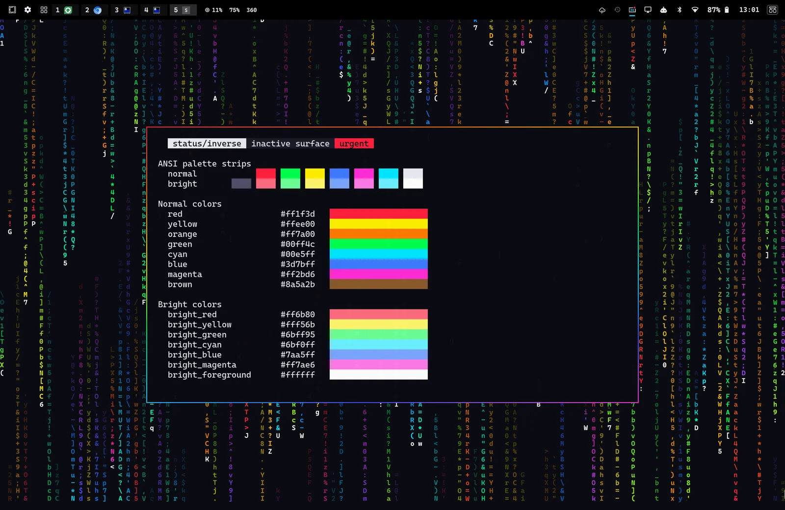
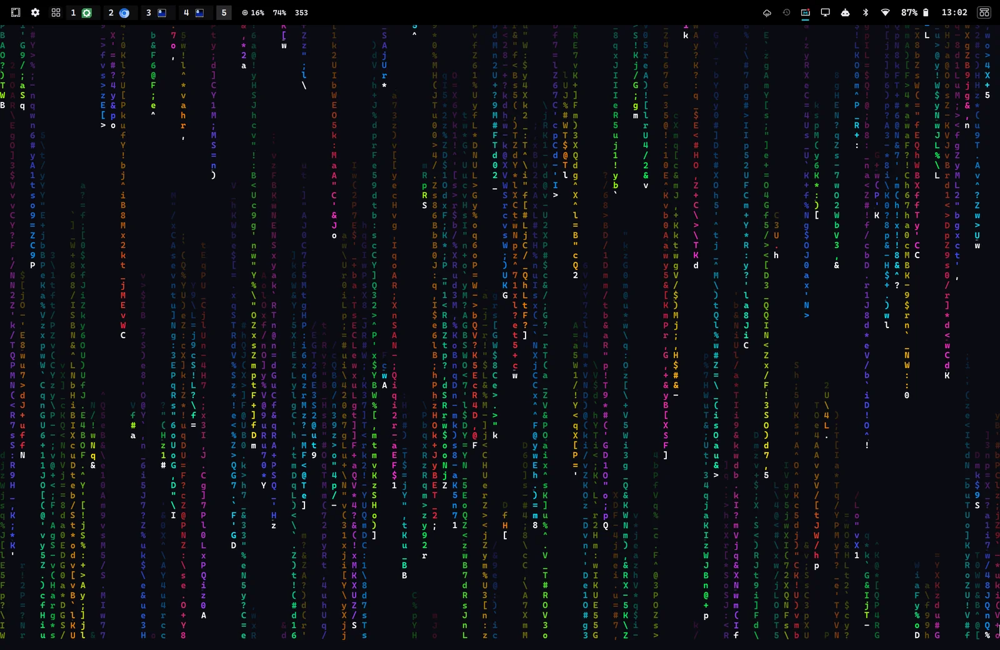

# Spectrum — an Omarchy theme

Full-rainbow RGB gaming lighting for [Omarchy](https://omarchy.org): saturated neon hues on a near-black chassis,
like a Razer Chroma keyboard in spectrum-cycling mode. Windows get a rainbow light-strip border, and the desktop
can run a live matrix rain in all twelve colors of the wheel with white tracer heads.



## What's in it

| File | What it does |
|---|---|
| `colors.toml` | The palette Omarchy builds every app's theme from (terminals, bar, menus, Hyprland, btop, Neovim…) |
| `claude.json` | Claude Code colors: magenta brand, cyan prompt, aqua suggestions, violet plan mode, amber auto-accept, orange bash border, azure IDE, lime memory |
| `icons.theme` | GTK icon theme: `Yaru-magenta-dark` |
| `omatrix.toml` | Settings for the live matrix-rain wallpaper (needs the [omatrix](https://github.com/0x1ocean/omarchy-omatrix) plugin; ignored without it) |
| `backgrounds/1-spectrum-glow.webp` | Static wallpaper, used when the rain is off |
| `preview.png` | Thumbnail for Omarchy's theme switcher (1800×1012, a real desktop) |
| `screenshots/` | The images in this README |
| `extras/omatrix/` | Optional patches for the omatrix plugin that add the 12-color rainbow rain ([details](extras/omatrix/README.md)) |

### Palette

The bright slots carry the in-between hues of the 12-hue wheel instead of paler copies, so a terminal shows
the whole rainbow:

| | Normal | Bright |
|---|---|---|
| Red | `#ff1f3d` | orange `#ff7a00` |
| Yellow | `#ffee00` | amber `#ffb000` |
| Green | `#00ff4c` | lime `#9dff00` |
| Cyan (accent) | `#00e5ff` | aqua `#00ffb3` |
| Blue | `#3d7bff` | azure `#0091ff` |
| Magenta | `#ff2bd6` | violet `#a355ff` |
| Background / Foreground | `#0b0b12` | `#eaeaf2` |

Active window border: a 45° red → orange → yellow → green → cyan → blue → magenta gradient.
There are no grey UI accents beyond the surfaces: everything that can be colored is a hue.

## Install

```bash
omarchy theme install https://github.com/WhiskeyTangoFussell/omarchy-spectrum-theme.git
```

This clones the theme into `~/.config/omarchy/themes/spectrum` and applies it straight away. It shows up as
**spectrum** in the theme switcher (`SUPER + SHIFT + CTRL + SPACE`).

**What installing changes:** the theme only supplies colors (including Claude Code's), an icon-theme name, a wallpaper and rain settings.
It contains no code: no `.lua` files, terminal configs or scripts, so it can't run anything. Omarchy refuses to
stage such files from a cloned theme anyway. Your own config files are not touched; switching to another theme
puts everything back.

Update later with `omarchy theme update`.

## Remove

```bash
omarchy theme set tokyo-night        # or any other theme, if Spectrum is the current one
omarchy theme remove spectrum        # deletes ~/.config/omarchy/themes/spectrum
```

If you applied the optional omatrix patches, see [removing them](extras/omatrix/README.md#remove). To remove
omatrix entirely: `omarchy plugin remove io.github.0x1ocean.omatrix`.

## The matrix rain (optional)



The simplest way to get it is the [Matrix Screens](https://github.com/WhiskeyTangoFussell/omarchy-matrix-screens)
shell plugin, which also puts the rain on the screensaver and lock screen. It reads Spectrum's rain colors from the
`matrix_*` keys in `colors.toml` (12 hues, white heads, `matrix_tail_fade = 0.5`, `matrix_tail_hue_shift = 6`), so
the full effect needs no patches:

```bash
omarchy plugin add https://github.com/WhiskeyTangoFussell/omarchy-matrix-screens --enable
```

Or use the [omatrix](https://github.com/0x1ocean/omarchy-omatrix) shell plugin, which turns on whenever the active
theme ships an `omatrix.toml`:

```bash
omarchy plugin add https://github.com/0x1ocean/omarchy-omatrix.git --enable
```

How it looks depends on which omatrix you have:

| omatrix | Rain |
|---|---|
| Not installed | No rain; the `1-spectrum-glow` wallpaper shows |
| Stock upstream | Classic green rain (the theme's `#00ff4c`) with white heads. The rainbow keys are ignored, nothing breaks |
| With the patches in [`extras/omatrix`](extras/omatrix/README.md) | The full effect in the screenshot: each stream picks one of 12 hues, its tail fades from bright to dark (`tail_fade = 0.85`) and drifts three steps round the color wheel (`tail_hue_shift = 3`), heads are white, and it updates at ~10.7 Hz |

The rain pauses behind fullscreen windows and while locked, and slows down on battery
(`on_battery = "slow"`). The rain costs about 0.02 W on an M2 MacBook Air, which is negligible.

## Requirements and dependencies

| Needed for | Dependency | Where it comes from |
|---|---|---|
| The theme | Omarchy 4 (shell release with `omarchy theme install`) | — |
| Icons | `Yaru-magenta-dark` | Ships with Omarchy |
| Font in the rain | `CaskaydiaCove Nerd Font Mono` | Omarchy's default font |
| The rain (optional) | [Matrix Screens](https://github.com/WhiskeyTangoFussell/omarchy-matrix-screens) or [omatrix](https://github.com/0x1ocean/omarchy-omatrix) shell plugin, GPL-3.0-or-later | `omarchy plugin add` |
| The rainbow rain with omatrix (optional) | The 4 patches in [`extras/omatrix`](extras/omatrix/README.md) | This repository |

Nothing else is downloaded or installed.

## Credits

- Theme: Fussell ([@WhiskeyTangoFussell](https://github.com/WhiskeyTangoFussell))
- Rain: [omatrix](https://github.com/0x1ocean/omarchy-omatrix) by 0x1ocean, a QML port of cmatrix
- [Omarchy](https://omarchy.org) by DHH and contributors

## License

The theme is MIT ([LICENSE](LICENSE)). The patches in `extras/omatrix` modify a GPL-3.0-or-later project and are
GPL-3.0-or-later too.
